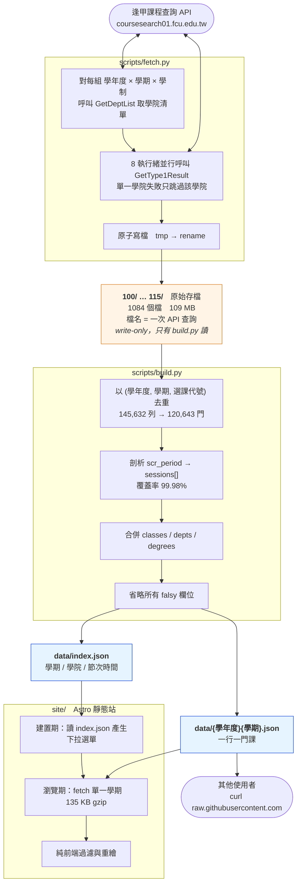
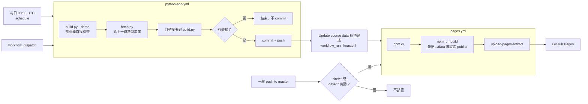
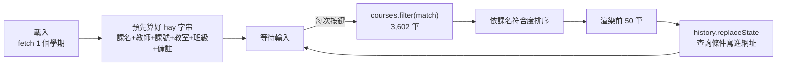

# 架構

## 資料流

關鍵設計：**raw 的結構壞掉沒關係，因為它被隔離在 `build.py` 後面。**
檔名 `1131-1-CI.json` 記的是「對 API 問了什麼」而不是「這是什麼」，
所以跨學院掛牌的課會被複製到多個檔（17.2% 的列是重複的）。
`build.py` 第一件事就是把檔名拆開丟掉、把 `total`/`message` 信封拆掉。

## 自動化

`build.py --demo` 跑在抓取之前，是刻意的：剖析器的自我檢查若壞了，
就不該用它去覆蓋既有的 `data/`。

## 為什麼前端不需要搜尋函式庫

搜尋與重繪都在瀏覽器執行。單一學期約 3,600 筆物件，
`String.includes` 就夠了；Fuse.js / MiniSearch 這種等級的工具在這裡是純負擔。
